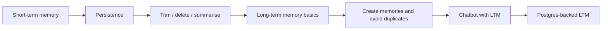

# Memory for LLMs

A hands-on, step-by-step exploration of how to give LLM applications **memory**. LLMs are stateless by default, so this repo implements both **short-term memory** (within a conversation) and **long-term memory** (across conversations) externally, progressing from simple chat history to a persistent Postgres-backed store.

## Why memory matters

An LLM only knows what's in its current prompt. To build assistants that stay coherent in a long conversation and remember users between sessions, you have to manage memory yourself:

| Type | Scope | Challenge |
|------|-------|-----------|
| **Short-term memory** | One conversation or thread | The context window is limited, so history must be trimmed, deleted, or summarised |
| **Long-term memory** | Across conversations and sessions | Deciding what to store, avoiding duplicates, and persisting it reliably |

## Learning path



## Notebooks

### Part 1: Short-term memory

| Notebook | What it covers |
|----------|----------------|
| `1_short_term_memory.ipynb` | Keeping conversation history so the model can follow a multi-turn chat |
| `2_shortTermMemory_Persistance.ipynb` | Persisting conversation state so a thread can be resumed |
| `3_stm_trimming.ipynb` | Trimming old messages to stay within the context window |
| `4_stm_deletion.ipynb` | Deleting specific messages from the history |
| `5_stm_summarization.ipynb` | Summarising older messages to keep context while saving tokens |

### Part 2: Long-term memory

| Notebook | What it covers |
|----------|----------------|
| `6_long_term_memory_basics.ipynb` | Core concepts: storing and retrieving memories across sessions |
| `7_Long_Term_Memory_Implementation.ipynb` | A working long-term memory implementation |
| `7b_ltm_creating_new_memories.ipynb` | Having the model create new memories from conversations |
| `7c_LTM_create_new_mem_no_duplicate.ipynb` | Preventing duplicate memories when saving new ones |
| `7d_chatbot_LTM_implementation.ipynb` | A chatbot that uses long-term memory end to end |
| `8_LTM_postgres.ipynb` | Moving long-term memory to a persistent Postgres database |

>  These descriptions are inferred from file names. Edit each to match what the notebook really does.

## Repository structure

```
Memory_For_LLMs/
├── 1_short_term_memory.ipynb
├── 2_shortTermMemory_Persistance.ipynb
├── 3_stm_trimming.ipynb
├── 4_stm_deletion.ipynb
├── 5_stm_summarization.ipynb
├── 6_long_term_memory_basics.ipynb
├── 7_Long_Term_Memory_Implementation.ipynb
├── 7b_ltm_creating_new_memories.ipynb
├── 7c_LTM_create_new_mem_no_duplicate.ipynb
├── 7d_chatbot_LTM_implementation.ipynb
├── 8_LTM_postgres.ipynb
├── docker-compose.yaml        # Postgres service for notebook 8
└── README.md
```

## Tech stack

- **Python**
- **LangGraph / LangChain** for agent state and memory 
- **PostgreSQL** for persistent long-term memory
- **Docker Compose** to run Postgres locally
- **Jupyter Notebook**
- **LLM provider:** `[e.g. Gemini / OpenAI]`

>  Confirm the framework: if you used something other than LangGraph (for example a different memory library), change this line and the install command below.

## Getting started

### Prerequisites

- Python 3.10 or higher
- Docker and Docker Compose (for the Postgres notebook)
- An API key for your LLM provider

### Installation

```bash
git clone https://github.com/SyedaNaziaGit/Memory_For_LLMs.git
cd Memory_For_LLMs
python -m venv venv
source venv/bin/activate        # Windows: venv\Scripts\activate
pip install langgraph langchain langchain-community jupyter
```

For the Postgres notebook, also install the Postgres drivers and checkpointer/store packages your notebook imports (for example `psycopg` and `langgraph-checkpoint-postgres`).

### Configuration

Create a `.env` file in the project root:

```env
[PROVIDER]_API_KEY=your_api_key_here
```

> Never commit your `.env` file.

### Start Postgres (for notebook 8)

```bash
docker compose up -d
```

Stop it when you're done:

```bash
docker compose down
```

### Run the notebooks

```bash
jupyter notebook
```

## Key concepts

- **Context window:** the fixed amount of text an LLM can read at once, which is why short-term memory needs trimming or summarising.
- **Thread-level memory:** state scoped to a single conversation.
- **Cross-thread memory:** facts stored outside any one conversation so they can be recalled later.
- **Deduplication:** checking existing memories before adding a new one, so the store doesn't fill with repeats.

---

---
## LLM Memory

A LLM at inference is just a Parameterized math function

## \(y=f_{\theta }(x)\)

But this Parameterized math function is Stateless

\(y=f_{\theta }(x)\)

A system is stateless if its output depends only on the current input, and not on anything that happened before.

Fact - LLMs don't have any intrinsic Memory

\(y=f_{\theta }(x)\)

Chat Interface (Smartphone Screen):

• User (10:01 AM): Hi my name is nitish

• LLM (10:01 AM): Hi Nitish how can I help you

• User (10:02 AM): What is my name?

• LLM (10:02 AM): I dont know


### Context Window 

The context window is the amount of text an LLM can read and remember at one time before answering.

\(y=f_{\theta }(x)\)


Context Window - 

The context window is the amount of text an LLM can read and remember at one time before answering.

\(y=f_{\theta }(x)\)

### In-context learning 

In contexr learning is an emergent ability that allows an LLM to use information and patterns present in the prompt itself, in addition to its trained parametric knowledge, to generate an answer.

The Solution

\(y=f_{\theta }(x)\)

Chat Interface (Smartphone Screen) & Mapping:

• User (10:01 AM): Hi my name is nitish \(\rightarrow x_{1}\)

• LLM (10:01 AM): Hi Nitish how can I help you \(\rightarrow y_{1}\)

• User (10:02 AM): What is my name? \(\rightarrow x_{2}\)

• LLM (10:02 AM): I dont know \(\rightarrow y_{2}\)

• \(y_1 = f_\theta(x_1)\)

• \(y_2 = f_\theta(x_2) \quad \text{X}\) (crossed out)

• \(y_2 = f_\theta(\text{con}(x_1, y_1, x_2))\) (with a checkmark arrow pointing to it)

---


### Problems with Short Term Memory

1. Short Term Memory is Fragile
   
• STM \(\rightarrow \) implements

• messages \(\rightarrow \) code reset / server

• persistent

• STM \(\rightarrow \) database


3. STM is thread-scoped

A. Loss of user continuity across conversations

B. Learning never compounds over time

C. Cross-thread reasoning is impossible

---
### Solution - We need a new kind of memory

Information that should survive:

• beyond a single conversation

• beyond a single session

• sometimes even beyond days or weeks

Things like:

• who the user is

• how the system is expected to behave for them

• what tends to work and what usually fails

• what decisions were already made in the past

It has to be selective.

Only information that proves to be stable, useful, and reusable should survive beyond a single thread. Everything else should naturally fade away.

---


---

## Persistence

###Steps

1. Install Docker -> docker.com

2. Launch Docker Desktop

3. Check if Docker is already installed -> docker --version

4. Create docker-compose.yml

5. docker compose up -d

6. docker ps

7. Install Python dependencies

---

## Context Overflow Problem


---


### Postgres Memory Store


1. Install docker

2. Run docker --version

3. docker run --name langgraph-postgres \

-e POSTGRES_USER=postgres \

-e POSTGRES_PASSWORD=postgres \

-e POSTGRES_DB=postgres \

-p 5442:5432 \

-d postgres:16

4. Run docker ps

---
