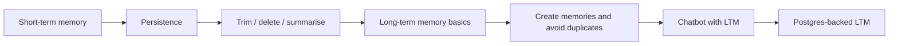

# Memory for LLMs

A hands-on, step-by-step exploration of how to give LLM applications **memory**. LLMs are stateless by default, so this repo implements both **short-term memory** (within a conversation) and **long-term memory** (across conversations) externally, progressing from simple chat history to a persistent Postgres-backed store.

## Why memory matters

An LLM only knows what's in its current prompt. To build assistants that stay coherent in a long conversation and remember users between sessions, you have to manage memory yourself:

| Type | Scope | Challenge |
|------|-------|-----------|
| **Short-term memory** | One conversation or thread | The context window is limited, so history must be trimmed, deleted, or summarised |
| **Long-term memory** | Across conversations and sessions | Deciding what to store, avoiding duplicates, and persisting it reliably |

## Learning path



## Notebooks

### Part 1: Short-term memory

| Notebook | What it covers |
|----------|----------------|
| `1_short_term_memory.ipynb` | Keeping conversation history so the model can follow a multi-turn chat |
| `2_shortTermMemory_Persistance.ipynb` | Persisting conversation state so a thread can be resumed |
| `3_stm_trimming.ipynb` | Trimming old messages to stay within the context window |
| `4_stm_deletion.ipynb` | Deleting specific messages from the history |
| `5_stm_summarization.ipynb` | Summarising older messages to keep context while saving tokens |

### Part 2: Long-term memory

| Notebook | What it covers |
|----------|----------------|
| `6_long_term_memory_basics.ipynb` | Core concepts: storing and retrieving memories across sessions |
| `7_Long_Term_Memory_Implementation.ipynb` | A working long-term memory implementation |
| `7b_ltm_creating_new_memories.ipynb` | Having the model create new memories from conversations |
| `7c_LTM_create_new_mem_no_duplicate.ipynb` | Preventing duplicate memories when saving new ones |
| `7d_chatbot_LTM_implementation.ipynb` | A chatbot that uses long-term memory end to end |
| `8_LTM_postgres.ipynb` | Moving long-term memory to a persistent Postgres database |

>  These descriptions are inferred from file names. Edit each to match what the notebook really does.

## Repository structure

```
Memory_For_LLMs/
├── 1_short_term_memory.ipynb
├── 2_shortTermMemory_Persistance.ipynb
├── 3_stm_trimming.ipynb
├── 4_stm_deletion.ipynb
├── 5_stm_summarization.ipynb
├── 6_long_term_memory_basics.ipynb
├── 7_Long_Term_Memory_Implementation.ipynb
├── 7b_ltm_creating_new_memories.ipynb
├── 7c_LTM_create_new_mem_no_duplicate.ipynb
├── 7d_chatbot_LTM_implementation.ipynb
├── 8_LTM_postgres.ipynb
├── docker-compose.yaml        # Postgres service for notebook 8
└── README.md
```

## Tech stack

- **Python**
- **LangGraph / LangChain** for agent state and memory 
- **PostgreSQL** for persistent long-term memory
- **Docker Compose** to run Postgres locally
- **Jupyter Notebook**
- **LLM provider:** `[e.g. Gemini / OpenAI]`

>  Confirm the framework: if you used something other than LangGraph (for example a different memory library), change this line and the install command below.

## Getting started

### Prerequisites

- Python 3.10 or higher
- Docker and Docker Compose (for the Postgres notebook)
- An API key for your LLM provider

### Installation

```bash
git clone https://github.com/SyedaNaziaGit/Memory_For_LLMs.git
cd Memory_For_LLMs
python -m venv venv
source venv/bin/activate        # Windows: venv\Scripts\activate
pip install langgraph langchain langchain-community jupyter
```

For the Postgres notebook, also install the Postgres drivers and checkpointer/store packages your notebook imports (for example `psycopg` and `langgraph-checkpoint-postgres`).

### Configuration

Create a `.env` file in the project root:

```env
[PROVIDER]_API_KEY=your_api_key_here
```

> Never commit your `.env` file.

### Start Postgres (for notebook 8)

```bash
docker compose up -d
```

Stop it when you're done:

```bash
docker compose down
```

### Run the notebooks

```bash
jupyter notebook
```

## Key concepts

- **Context window:** the fixed amount of text an LLM can read at once, which is why short-term memory needs trimming or summarising.
- **Thread-level memory:** state scoped to a single conversation.
- **Cross-thread memory:** facts stored outside any one conversation so they can be recalled later.
- **Deduplication:** checking existing memories before adding a new one, so the store doesn't fill with repeats.

---
